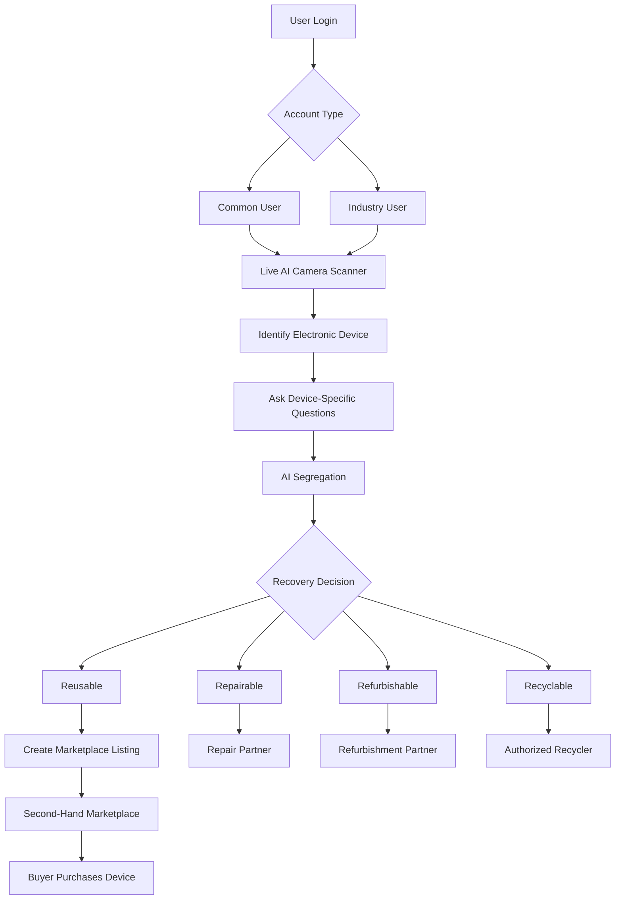

# ♻ Punarth AI — E-waste Recovery & Second-Hand Electronics Marketplace

A **desktop application** (Windows / macOS / Linux) that lets a user put an electronic device in front of
the camera, have AI identify it, answer a few condition questions, get a **recovery decision**
(Reusable / Repairable / Refurbishable / Recyclable / Hazardous / Requires Manual Inspection), see an
**estimated resale value**, and **sell it on the built-in marketplace**, where other users can browse, buy and pay
securely through Razorpay.



---

## 1. Quick start (5 minutes)

You need **Python 3.10+** installed.

**Windows:** double-click `run.bat` (first run creates a virtual environment and installs everything).

**macOS / Linux:**
```bash
./run.sh
```

**Or manually:**
```bash
python -m venv .venv
.venv\Scripts\activate          # Windows
source .venv/bin/activate       # macOS / Linux
pip install -r requirements.txt
python main.py
```

The first launch creates a database with demo data (16 listings, 5 users and recovery partners).

### Demo accounts (password `demo123`)
| Account | Email | Type |
|---|---|---|
| Asha Rao | `asha@demo.in` | Common user (verified) |
| Rohan Mehta | `rohan@demo.in` | Common user |
| Priya Nair | `priya@demo.in` | Common user |
| GreenCycle Refurbishers | `greencycle@demo.in` | Industry user (Business plan) |
| TechReuse Solutions | `techreuse@demo.in` | Industry user |

The sign-in screen has one-click **Common user** / **Industry user** demo buttons.

### Turn on offline device detection (recommended)
The AI Scanner runs a YOLOv8 model locally. You only need to download it once:
```bash
pip install ultralytics
python tools/get_model.py        # creates models/yolov8n.onnx
```
Without it, the scanner still works: capture or upload a photo and pick the category yourself.

### Optional: brand & model recognition
Copy `.env.example` to `.env` and set `ANTHROPIC_API_KEY`. The scanner then also recognises
brand / model and describes visible defects from the photo.

---

## 2. Payments (Razorpay)

Payments are handled by a **separate payment server** (`payment_server/server.py`, Flask). The desktop app can
only *start* a payment and *read* its status. It never marks anything as paid.

* The server creates the Razorpay order with the amount computed from the database (not sent by the app).
* After checkout, the server verifies the **HMAC signature** and fetches the payment from Razorpay's API to
  confirm the amount and status before marking the order paid.
* **Webhooks** (`/webhooks/razorpay`, signature-verified) confirm payments even if the buyer closes the browser.
* Orders stay in *Pending Payment* until the server confirms. If two buyers pay for the last unit, the second
  order is flagged *Refund Required*.

The app starts the payment server automatically. You can also run it yourself:
```bash
python -m payment_server.server
```

**Demo mode (default, no keys):** the checkout page shows "Simulate successful / failed payment" buttons. The
result is still recorded by the server.

**Real Razorpay (test mode):**
1. Create test API keys in the Razorpay Dashboard and put them in `.env`
   (`RAZORPAY_KEY_ID`, `RAZORPAY_KEY_SECRET`).
2. For webhooks, the server must be reachable from the internet. For a local demo use a tunnel, e.g.
   `ngrok http 5055`, then add a webhook in the Razorpay Dashboard at
   `https://<your-ngrok-url>/webhooks/razorpay` with events `payment.captured`, `payment.failed`, `order.paid`,
   and put its secret in `RAZORPAY_WEBHOOK_SECRET`.
3. Restart the app. Checkout now opens real Razorpay Checkout (UPI, cards, netbanking, wallets).

> In production, run the payment server and database on a hosted server; the desktop app would talk to it
> over HTTPS. For the hackathon both run on one machine and share the SQLite file.

---

## 3. What's inside (mapped to the requirements)

| Requirement | Where |
|---|---|
| Common & Industry login, separate sidebars, **Marketplace item in both** | `ui/pages/login.py`, `ui/main_window.py` |
| Live AI camera scanner, detection overlay, upload photo fallback | `ui/pages/scanner.py`, `core/vision.py` |
| Device-specific questions (12 categories) | `core/catalog.py` |
| AI Segregation: 6 classifications with reasons and confidence | `core/assessment.py` |
| Resale value range + suggested price, repair cost, refurbished value | `core/assessment.py` |
| Recovery pathways (sell, reuse, donate, repair partner, refurbishment, recycling, recovery report) | scanner result + `ui/pages/recovery.py` |
| **Hazardous devices can't be listed** (enforced in the core, not just the UI) | `marketplace.check_listing_safety` |
| Condition grades: Like New · Excellent · Good · Fair · For Parts / Repair, explained everywhere | `catalog.CONDITION_DESCRIPTIONS` |
| Functionality never claimed from an image; source shown (seller reported / tested / verified inspection) | `assessment.py`, product page |
| AI listing assistant: title, description, category, brand/model, condition, defects, value, price | `core/listing_ai.py` |
| **AI-generated vs user-confirmed** fields (purple *AI* badges → *Edited*; buyers see the source) | `ui/pages/sell.py`, product page |
| Marketplace pages: Home, Browse, Product Details, Sell, Create Listing, My Listings, My Orders, My Purchases, Cart, Wishlist, Checkout, Seller Dashboard | `ui/pages/*` |
| Product cards (image, name, brand/model, condition, price, seller, location, verification, View button) | `ui/widgets.py → ProductCard` |
| Filters: category, brand, price, condition, location, seller type, verified, recently listed + search + sort | `ui/pages/browse.py` |
| Product details: gallery, specs, defects, AI summary (with disclaimer), seller, delivery/pickup, Q&A, cart/buy/wishlist/contact | `ui/pages/product.py` |
| Cart with quantities, per-seller delivery charges, add-on services, order summary | `ui/pages/cart.py` |
| Razorpay checkout, server-side verification, webhooks, order confirmation, history, tracking timeline | `payment_server/server.py`, `ui/pages/orders.py` |
| Seller dashboard: 8 stats, edit/delete/mark sold, manage orders, answer questions, sales history | `ui/pages/seller.py` |
| Revenue model: commission per plan, seller subscriptions, featured listings (₹49/7 days), business sellers, refurbishment partners, buyer/seller services | `catalog.SELLER_PLANS`, `SERVICES` |
| Green & white premium UI, animated cards, wishlist heart pop, cart badge bounce, page cross-fades, toasts; dark "lab" look for the scanner | `ui/theme.py`, `ui/widgets.py` |

### Project layout
```
main.py                  desktop app entry point
core/                    all business logic (no UI) — testable
  catalog.py             categories, grades, brands, questions, plans
  assessment.py          grading, AI segregation, pricing, recommendations
  listing_ai.py          AI listing drafts + provenance
  marketplace.py         listings, search, cart, checkout, orders, payments state, Q&A, stats
  vision.py              YOLO ONNX detector, defect heuristic, optional cloud vision
  payments_client.py     desktop → payment server (start / status only)
  auth.py, db.py, seed.py, config.py
payment_server/server.py Razorpay orders, verification, webhooks, checkout page
ui/                      PySide6 desktop UI (pages, widgets, theme)
tests/                   pytest suite (core + payment server + vision)
tools/get_model.py       downloads & exports the YOLO detector
```

---

## 4. Suggested hackathon demo (3 minutes)

1. Sign in as **Common user** → Dashboard shows impact stats.
2. **AI Scanner** → hold up a phone → *Capture & analyse* → confirm the category → answer questions →
   result: **Reusable**, grade, value range and suggested price, with reasons.
3. **Create marketplace listing** → fields arrive pre-filled with purple **AI** badges → change the price
   (badge turns *Edited*) → tick the review box → **Preview** → **Publish**.
4. Show safety: scan again, answer *battery swollen = Yes* → **Hazardous** → no listing allowed, only
   authorised collection.
5. Sign out → sign in as **Industry user** → Marketplace → open a listing → **Buy Now** → Checkout → pay
   (demo page) → app shows "Payment verified by the server" → **My Orders** tracking.
6. Sign back in as the seller → **Seller Dashboard** → *Manage Orders* → mark Confirmed → Shipped → Delivered.

## 5. Tests
```bash
python -m pytest -q
```

## 6. Build a Windows .exe
```bat
build_exe.bat
```
Creates `dist\PunarthAI\PunarthAI.exe` (data, models and `.env` live next to the exe).

## Notes & limits
* Resale prices are estimates from category baselines, age, condition and answers — they're labelled as estimates.
* The image defect check flags *possible* cracks/deep scratches only; it's shown as supporting information.
* Recovery partners in the demo data are sample entries.
